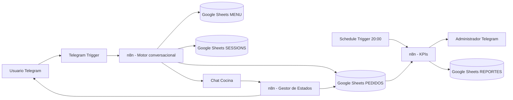

# DeliveryBot – Gestión de Pedidos Internos de Cafetería

DeliveryBot digitaliza el ciclo completo de pedidos internos de una cafetería usando **Telegram + n8n + Google Sheets**. El usuario navega un menú conversacional, agrega productos al carrito, confirma su orden y recibe notificaciones cuando el pedido cambia de estado. Cocina administra el ciclo operativo y la administración recibe un reporte diario de ventas.

## Arquitectura




## Módulos

1. **Pedidos Telegram**
   - `/start` o `/menu`
   - Categorías: Bebidas, Comidas y Snacks.
   - Selección de producto y cantidades.
   - Carrito temporal persistido en `SESSIONS`.
   - Validación de stock antes de confirmar.
   - Generación de ID `DB-AAAAMMDD-XXXXXX`.
   - Registro en `PEDIDOS`.
   - Descuento de stock.
   - Aviso inmediato a cocina.

2. **Cocina y Estados**
   - Estados soportados: `Recibido`, `Preparación`, `En camino`, `Entregado`, `Cancelado`.
   - El cambio de estado actualiza `PEDIDOS`.
   - El usuario recibe una notificación automática por Telegram.

3. **Reporte Diario**
   - Ejecución programada a las 20:00, zona horaria `America/Bogota`.
   - Total vendido.
   - Número de pedidos.
   - Ticket promedio.
   - Producto estrella.
   - Hora pico.
   - Guarda el resumen en `REPORTES` y lo envía al administrador.

## Estructura del repositorio

```text
Proyecto_DeliveryBot_Carval/
├── README.md
├── .env.example
├── deliverybot.manifest.json
├── workflows/
│   ├── 01_DeliveryBot_Pedidos_Telegram.json
│   ├── 02_DeliveryBot_Cocina_Estados.json
│   └── 03_DeliveryBot_Reporte_Diario.json
├── data/
│   ├── DeliveryBot_DB.xlsx
│   ├── MENU.csv
│   ├── PEDIDOS.csv
│   ├── USUARIOS.csv
│   ├── SESSIONS.csv
│   ├── CONFIG.csv
│   └── REPORTES.csv
└── docs/
    ├── CONFIGURACION.md
    └── CASOS_DE_PRUEBA.md
```

## Puesta en marcha

### 1. Crear el bot de Telegram

1. Abrir `@BotFather` en Telegram.
2. Ejecutar `/newbot`.
3. Definir nombre y username.
4. Copiar el token.
5. En n8n crear una credencial **Telegram API** con ese token.

> Nunca subas el token real al repositorio.

### 2. Crear Google Sheets

1. Sube `data/DeliveryBot_DB.xlsx` a Google Drive.
2. Ábrelo con Google Sheets y conviértelo a formato Google Sheets.
3. Verifica las hojas: `MENU`, `PEDIDOS`, `USUARIOS`, `SESSIONS`, `CONFIG`, `REPORTES`.
4. Copia el ID del documento desde la URL de Google Sheets.
5. Reemplaza `REEMPLAZAR_GOOGLE_SHEET_ID` en los nodos Google Sheets o selecciónalo desde el editor de n8n.

### 3. Importar workflows en n8n

Importa los JSON de la carpeta `workflows/`. Después:

- Asigna la credencial de Telegram a todos los nodos Telegram/Telegram Trigger.
- Asigna la credencial de Google Sheets a todos los nodos Google Sheets.
- Configura el Google Sheet correcto.
- Sustituye:
  - `REEMPLAZAR_CHAT_COCINA_ID`
  - `REEMPLAZAR_CHAT_ADMIN_ID`
- Mantén la zona horaria de los workflows en `America/Bogota`.
- Prueba primero de forma manual.
- Activa los workflows cuando todas las pruebas pasen.

## Datos

### MENU
`id_producto, nombre, descripcion, precio, categoria, stock, activo`

### PEDIDOS
`id_pedido, id_usuario, detalles_pedido, total_pago, estado, fecha, hora, departamento_oficina, canal, ultima_actualizacion`

### USUARIOS
`telegram_id, nombre_completo, departamento_oficina, puntos_lealtad, activo, fecha_registro`

### SESSIONS
`telegram_id, pantalla_actual, carrito_temporal, ultimo_cambio, categoria_actual`

### CONFIG
Parámetros operativos: moneda, impuestos, descuento, chat de cocina, chat administrador y timezone.

### REPORTES
Resumen diario de ventas y KPIs.

## Contrato de callbacks

Los botones inline usan estos formatos:

```text
MENU
CAT:Bebidas
CAT:Comidas
CAT:Snacks
PROD:BEB001
ADD:BEB001:2
CART
CLEAR
CONFIRM
STATUS
HISTORY
STATE:DB-20260811-123456:Preparación
STATE:DB-20260811-123456:En camino
STATE:DB-20260811-123456:Entregado
```

## Regla de negocio de stock

El stock se valida dos veces: al seleccionar cantidad y nuevamente justo antes de confirmar. Esta segunda validación reduce ventas por encima del inventario cuando varios usuarios compran al mismo tiempo.

Para un entorno de alta concurrencia, se recomienda migrar `MENU/PEDIDOS/SESSIONS` a PostgreSQL y dejar Google Sheets como capa administrativa/reporting.

## Seguridad

- No incluir tokens, secretos ni IDs sensibles en GitHub.
- Limitar acceso de edición del Google Sheet.
- Restringir el workflow de cocina a un grupo/chat autorizado.
- Mantener n8n bajo HTTPS.
- Usar variables/credenciales de n8n, no valores secretos escritos en nodos.
- Habilitar manejo de errores y alertas antes de producción.

## Métricas de éxito

- Pedidos registrados automáticamente: objetivo 100%.
- Reducción del tiempo de espera: meta 40%.
- Exactitud de stock: > 98%.
- Pedidos con trazabilidad completa de estado: 100%.
- Reporte diario emitido automáticamente: 100%.

## Limitaciones de esta entrega

Los workflows se entregan con **credenciales desacopladas** por seguridad. Al importar, n8n puede pedir re-seleccionar credenciales y, dependiendo de la versión exacta de tu instancia, confirmar algunos campos del nodo Google Sheets/Telegram. La lógica de negocio y las expresiones están incluidas.

No se incluye un enlace real de Google Sheets porque requiere acceso a una cuenta de Google del propietario. El archivo `DeliveryBot_DB.xlsx` está preparado para subir y convertir en Google Sheets.

## Mejoras recomendadas – Fase 2

- Registro guiado de oficina/ubicación del usuario.
- Pago interno o QR.
- Cupones y puntos de fidelización.
- Tiempo estimado de preparación.
- Dashboard Looker Studio.
- Control de horario de cafetería.
- Pausa automática de productos agotados.
- Roles de cocina/administrador.
- Cancelación con reglas por estado.
- PostgreSQL para concurrencia y auditoría.


---

## Update: Examen [Número]

### Objetivo de la actualización

Se incorporó un sistema de puntos de lealtad en DeliveryBot. Por cada pedido confirmado, el usuario acumula **1 punto por cada $5.00 gastados**. Los puntos se almacenan en la columna `puntos_lealtad` de la hoja `USUARIOS` y pueden consultarse desde el Menú Principal de Telegram.

### Lógica implementada

El cálculo se ejecuta únicamente cuando el pedido fue confirmado correctamente.

Flujo agregado:

```text
¿Confirmó Pedido?
        |
   Guardar Pedido
        |
Buscar Usuario por telegram_id
        |
Calcular Puntos (Edit Fields)
        |
Actualizar Puntos Usuario
        |
    Avisar Cocina
```

#### 1. Buscar usuario

El nodo **Buscar Usuario por telegram_id** toma el `id_usuario` del pedido confirmado y localiza el registro correspondiente dentro de los datos leídos desde la hoja `USUARIOS`.

La llave de búsqueda es:

```text
telegram_id
```

#### 2. Calcular puntos

El nodo **Calcular Puntos (Edit Fields)** usa una expresión matemática de n8n.

```javascript
Math.floor(Number($('Motor Conversacional').first().json.order.total_pago || 0) / 5)
```

Variables calculadas:

- `puntos_actuales`: balance que ya tenía el usuario.
- `puntos_nuevos`: puntos obtenidos en la compra actual.
- `puntos_totales`: suma de puntos anteriores más los nuevos.

Fórmula:

```text
puntos_nuevos = floor(total_pago / 5)
puntos_totales = puntos_actuales + puntos_nuevos
```

Ejemplo:

```text
Compra: $23.00
Puntos nuevos: floor(23 / 5) = 4
```

#### 3. Persistencia en Google Sheets

El nodo **Actualizar Puntos Usuario** actualiza la hoja `USUARIOS`, haciendo matching por `telegram_id`.

Campos actualizados:

```text
telegram_id
puntos_lealtad
```

De esta manera, el balance permanece guardado para las siguientes compras.

### Nueva opción del Menú Principal

Se agregó el botón:

```text
🏆 4. Ver mis Puntos
```

Callback utilizado:

```text
POINTS
```

Al seleccionar la opción, el bot busca el perfil del usuario y responde:

```text
Hola [Nombre], actualmente tienes 🏆 [Puntos] puntos acumulados. ¡Sigue comprando para canjear premios!
```

También se ajustó `/start` para mostrar el Menú Principal y facilitar el acceso a esta opción.

### Prueba recomendada

1. Verificar en `USUARIOS` el valor inicial de `puntos_lealtad`.
2. Realizar un pedido desde Telegram.
3. Confirmar el pedido.
4. Verificar que el workflow ejecute:
   - `Buscar Usuario por telegram_id`
   - `Calcular Puntos (Edit Fields)`
   - `Actualizar Puntos Usuario`
5. Revisar que `puntos_lealtad` haya aumentado en Google Sheets.
6. Ejecutar `/start`.
7. Pulsar **🏆 4. Ver mis Puntos**.
8. Confirmar que Telegram muestre el saldo actualizado.

### Evidencias para entregar

Guardar las capturas dentro de una carpeta como:

```text
docs/Evidencias/Examen/
```

Capturas requeridas:

1. **n8n:** mostrar en el canvas los nodos nuevos:
   - `Buscar Usuario por telegram_id`
   - `Calcular Puntos (Edit Fields)`
   - `Actualizar Puntos Usuario`

2. **Telegram:** mostrar el botón **🏆 4. Ver mis Puntos** y el mensaje de respuesta con nombre y puntos acumulados.

3. **Google Sheets:** mostrar la fila del usuario en `USUARIOS`, incluyendo:
   - `telegram_id`
   - `nombre_completo`
   - `puntos_lealtad`

### Nota de configuración

Los workflows mantienen las credenciales desacopladas. Después de importar el JSON en n8n se debe:

- seleccionar la credencial de Telegram;
- seleccionar la credencial de Google Sheets;
- reemplazar `REEMPLAZAR_GOOGLE_SHEET_ID` o seleccionar el documento desde el nodo;
- ejecutar una prueba antes de activar el workflow.

> Cambia `[Número]` por el número real del examen antes de entregar el repositorio.


---

## Update: Examen [Número]

### Control de Horarios de Atención

Se implementó una restricción horaria para evitar que DeliveryBot procese pedidos cuando la cafetería se encuentra cerrada.

El horario configurado es:

```text
Lunes a Viernes
08:00 AM a 05:00 PM
Zona horaria: America/Bogota
```

### Objetivo de la lógica

La solución diferencia dos acciones:

- **Realizar pedido:** solo está permitido dentro del horario de atención.
- **Consultar menú:** está permitido en cualquier momento, incluso cuando la cafetería está cerrada.

Adicionalmente, se agregó un segundo control antes de procesar `CONFIRM`, para impedir que un usuario abra un carrito durante el horario laboral y trate de confirmarlo después de las 5:00 PM.

### Nodos agregados

```text
¿Horario de Atención?
¿Confirmación en Horario?
Cafetería Cerrada
```

### Flujo al elegir "Realizar pedido"

```text
Usuario pulsa "🛒 Realizar pedido"
             |
       Motor Conversacional
             |
       Enrutar Pantalla
             |
     ¿Horario de Atención?
          /       \
        Sí         No
        |           |
 Categorías   Cafetería Cerrada
```

El nodo **¿Horario de Atención?** utiliza `$now` para validar el día y la hora actual.

Expresión implementada:

```javascript
{{ $now.weekday >= 1
   && $now.weekday <= 5
   && (($now.hour * 60) + $now.minute) >= 480
   && (($now.hour * 60) + $now.minute) <= 1020 }}
```

Interpretación:

```text
$now.weekday 1 a 5 = Lunes a Viernes
480 minutos         = 08:00
1020 minutos        = 17:00
```

Si la expresión devuelve `true`, el usuario continúa al catálogo para realizar su pedido.

Si devuelve `false`, el flujo se detiene y Telegram responde:

```text
🌙 Cafetería Cerrada. Nuestro horario es de Lunes a Viernes, 8am a 5pm. ¡Te esperamos mañana!
```

### Protección de la confirmación

Se agregó el nodo **¿Confirmación en Horario?** antes de `Motor Conversacional`.

Este nodo permite que todas las acciones normales continúen, pero si el callback recibido es `CONFIRM`, vuelve a validar `$now`.

```text
Sincronizar Datos
       |
¿Confirmación en Horario?
     /       \
   Sí         No
   |           |
Motor     Cafetería Cerrada
```

Con esta validación, un carrito creado antes de las 5:00 PM no puede convertirse en pedido después del cierre.

Al bloquear la confirmación antes del `Motor Conversacional`:

- no se genera `id_pedido`;
- no se registra el pedido en Google Sheets;
- no se descuenta inventario;
- no se calculan puntos;
- no se notifica a cocina;
- el carrito no se vacía.

### Excepción: Consultar menú

Se agregó al Menú Principal la opción:

```text
📋 Consultar menú
```

Callback:

```text
VIEW_MENU
```

Esta opción muestra los productos y precios en modo de solo lectura.

No muestra botones para:

```text
Agregar producto
Seleccionar cantidad
Confirmar pedido
```

Por esta razón el usuario puede consultar el catálogo fuera del horario sin generar pedidos.

### Menú Principal actualizado

```text
🛒 Realizar pedido
📋 Consultar menú
🧺 Ver carrito
📦 Estado
📜 Historial
🏆 4. Ver mis Puntos
```

### Pruebas recomendadas

#### Prueba 1 - Dentro del horario

Ejecutar el workflow de lunes a viernes entre 08:00 y 17:00.

Resultado esperado:

```text
Realizar pedido → Categorías → Productos → Carrito → Confirmar pedido
```

El pedido debe registrarse normalmente.

#### Prueba 2 - Fuera del horario

Ejecutar después de las 17:00, antes de las 08:00 o durante sábado/domingo.

Pulsar:

```text
🛒 Realizar pedido
```

Resultado esperado:

```text
🌙 Cafetería Cerrada. Nuestro horario es de Lunes a Viernes, 8am a 5pm. ¡Te esperamos mañana!
```

#### Prueba 3 - Consulta fuera del horario

Desde el mensaje de cierre pulsar:

```text
📋 Consultar menú
```

Resultado esperado:

- se muestran productos y precios;
- no se habilita la confirmación de pedidos.

#### Prueba 4 - Carrito creado antes del cierre

1. Crear un carrito antes de las 17:00.
2. Intentar pulsar `Confirmar pedido` después de las 17:00.
3. Verificar que el nodo **¿Confirmación en Horario?** tome la salida `false`.
4. Confirmar que el pedido no llegue a `Guardar Pedido`.

### Capturas de pantalla requeridas

Guardar las evidencias, por ejemplo, en:

```text
docs/Evidencias/Examen_Horarios/
```

#### Captura 1 - Canvas n8n

Debe mostrar claramente:

```text
¿Horario de Atención?
¿Confirmación en Horario?
Cafetería Cerrada
```

Idealmente también deben verse `Enrutar Pantalla`, `Motor Conversacional` y `Responder Categorias` para demostrar la ubicación de los controles.

#### Captura 2 - Telegram

Realizar la prueba fuera del horario y capturar el mensaje:

```text
🌙 Cafetería Cerrada. Nuestro horario es de Lunes a Viernes, 8am a 5pm. ¡Te esperamos mañana!
```

En la misma evidencia puede mostrarse el botón:

```text
📋 Consultar menú
```

#### Captura 3 - Google Sheets

Este examen **no requiere escribir un dato nuevo en Google Sheets cuando el flujo está cerrado**.

Como evidencia opcional, puede mostrarse que después del intento fuera del horario:

- no apareció una nueva fila en `PEDIDOS`;
- el stock de `MENU` no cambió;
- los puntos del usuario no cambiaron.

### Configuración posterior a la importación

Después de importar el JSON en n8n:

1. Seleccionar la credencial de Telegram en los nodos Telegram.
2. Seleccionar la credencial de Google Sheets.
3. Confirmar el documento de Google Sheets.
4. Mantener la zona horaria del workflow en `America/Bogota`.
5. Ejecutar primero una prueba manual.
6. Activar el workflow después de validar ambos escenarios: abierto y cerrado.

> Reemplazar `[Número]` por el número real del examen antes de entregar.
